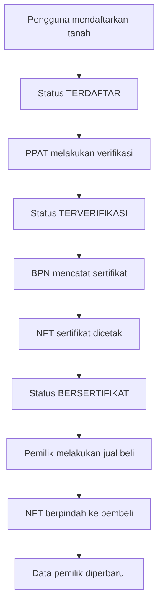

# 🏡 Land Registration System Blockchain

Aplikasi simulasi registrasi tanah, verifikasi oleh PPAT, pencatatan sertifikat oleh BPN, dan perpindahan kepemilikan tanah berbasis blockchain menggunakan Solidity, Hardhat, Streamlit, dan MetaMask.

---

## 1. Deskripsi Project

Land Registration System merupakan aplikasi berbasis blockchain yang dirancang untuk mensimulasikan proses registrasi tanah, verifikasi data tanah oleh PPAT, pencatatan sertifikat oleh BPN, serta proses jual beli tanah melalui perpindahan kepemilikan NFT.

Data tanah dicatat pada smart contract Ethereum-compatible. Sertifikat tanah direpresentasikan sebagai NFT (Non-Fungible Token) menggunakan standar ERC-721. Sistem menerapkan pembagian hak akses antara admin, PPAT, BPN, dan pemilik tanah untuk membatasi proses tertentu berdasarkan peran wallet.

Aplikasi ini menggunakan blockchain lokal Hardhat sebagai lingkungan pengujian dan MetaMask sebagai wallet untuk berinteraksi dengan smart contract.

## 2. Teknologi yang Digunakan

| Teknologi | Fungsi |
|---|---|
| Solidity | Bahasa pemrograman smart contract. |
| Hardhat | Kompilasi, deployment, dan penyedia blockchain lokal. |
| OpenZeppelin ERC-721 | Implementasi standar NFT untuk sertifikat tanah. |
| Python | Backend dashboard dan integrasi blockchain. |
| Streamlit | Dashboard monitoring dan interface utama. |
| Web3.py | Komunikasi antara Python dan blockchain. |
| Ethers.js | Interaksi frontend DApp dengan smart contract. |
| MetaMask | Wallet untuk autentikasi akun dan persetujuan transaksi. |

## 3. Struktur Project

```text
land-registration/
├── app.py
├── actors.json
├── deployment.json
├── hardhat.config.js
├── package.json
├── package-lock.json
├── contracts/
│   ├── LandRegistration.sol
│   └── Lock.sol
├── scripts/
│   └── deploy.js
├── ignition/
│   └── modules/
├── test/
├── artifacts/
├── cache/
└── README.md
```

Penjelasan file utama:

- `app.py` — dashboard Streamlit, integrasi Web3.py, frontend DApp, pembacaan data, dan riwayat blockchain.
- `contracts/LandRegistration.sol` — smart contract utama yang mengelola data tanah, verifikasi, sertifikat NFT, hak akses, dan jual beli.
- `contracts/Lock.sol` — smart contract contoh bawaan template Hardhat.
- `actors.json` — konfigurasi alamat wallet PPAT dan BPN yang digunakan saat deployment.
- `deployment.json` — informasi deployment berupa nama kontrak, alamat kontrak, jaringan, Chain ID, serta alamat wallet PPAT dan BPN.
- `scripts/deploy.js` — script untuk deployment kontrak, penetapan role PPAT dan BPN, serta penyimpanan data deployment.
- `hardhat.config.js` — konfigurasi Solidity dan jaringan Hardhat Local.
- `artifacts/` — hasil kompilasi smart contract, termasuk ABI yang digunakan aplikasi.
- `package.json` dan `package-lock.json` — konfigurasi serta dependency Node.js.

## 4. Persiapan Lingkungan

Pastikan perangkat telah memiliki:

- Node.js dan npm.
- Python.
- MetaMask pada browser.

### 4.1 Clone repository

```bash
git clone https://github.com/dafarevanzajoanputra-art/BlockChain_KEL9.git
cd BlockChain_KEL9
```

### 4.2 Instalasi dependency Node.js

```bash
npm install
```

Perintah ini memasang dependency Hardhat, Hardhat Toolbox, dan OpenZeppelin yang dibutuhkan untuk kompilasi serta deployment smart contract.

### 4.3 Instalasi dependency Python

Buat virtual environment:

**Windows:**

```bash
python -m venv venv
```

Aktifkan virtual environment:

```bash
venv\Scripts\activate
```

Install dependency Python:

```bash
pip install streamlit web3
```

## 5. Menjalankan Aplikasi

### Langkah 1 - Jalankan blockchain lokal

Buka terminal pertama di folder project dan jalankan:

```bash
npx hardhat node
```

Perintah ini menjalankan blockchain lokal Hardhat pada alamat RPC:

```text
http://127.0.0.1:8545
```

Hardhat menyediakan akun pengujian beserta saldo ETH lokal untuk transaksi simulasi.

Terminal ini harus tetap berjalan selama aplikasi digunakan.

### Langkah 2 - Kompilasi smart contract

Buka terminal kedua di folder project.

```bash
npx hardhat compile
```

Perintah ini mengompilasi smart contract Solidity dan menghasilkan ABI serta bytecode di dalam folder `artifacts/`.

ABI digunakan oleh aplikasi untuk berkomunikasi dengan fungsi smart contract.

### Langkah 3 - Konfigurasi wallet aktor

Periksa file `actors.json`.

```json
{
  "ppat": "ALAMAT_WALLET_PPAT",
  "bpn": "ALAMAT_WALLET_BPN"
}
```

Ganti alamat wallet sesuai aktor yang digunakan dalam simulasi.

Alamat wallet PPAT dan BPN harus berbeda dan valid.

### Langkah 4 - Deploy smart contract

Pastikan blockchain Hardhat Local pada terminal pertama masih berjalan.

Pada terminal kedua, jalankan:

```bash
npx hardhat run scripts/deploy.js --network localhost
```

Script deployment melakukan proses berikut:

1. Membaca alamat wallet PPAT dan BPN dari `actors.json`.
2. Memvalidasi alamat wallet.
3. Memastikan alamat PPAT dan BPN tidak sama.
4. Melakukan deployment smart contract `LandRegistration`.
5. Menetapkan role PPAT pada wallet yang dikonfigurasi.
6. Menetapkan role BPN pada wallet yang dikonfigurasi.
7. Menyimpan alamat smart contract dan informasi deployment ke `deployment.json`.

Setelah deployment berhasil, file `deployment.json` akan diperbarui secara otomatis.

### Langkah 5 - Jalankan dashboard

Pastikan virtual environment Python aktif.

```bash
streamlit run app.py
```

Dashboard akan dibuka melalui browser, umumnya pada:

```text
http://localhost:8501
```

Dashboard digunakan untuk memantau koneksi blockchain lokal, Chain ID, block terbaru, RPC URL, serta alamat smart contract.

### Langkah 6 - Buka frontend DApp

Pada dashboard Streamlit, klik tombol:

**Buka Frontend Land Registration**

Frontend DApp akan dibuka pada browser melalui:

```text
http://127.0.0.1:8502
```

Frontend menggunakan MetaMask untuk menghubungkan wallet dan mengirim transaksi ke smart contract.

## 6. Konfigurasi MetaMask

Untuk berinteraksi dengan aplikasi, MetaMask harus terhubung ke jaringan Hardhat Local.

Tambahkan jaringan berikut jika belum tersedia:

| Konfigurasi | Nilai |
|---|---|
| Network Name | Hardhat Local |
| RPC URL | `http://127.0.0.1:8545` |
| Chain ID | `31337` |
| Currency Symbol | ETH |

Import akun pengujian Hardhat ke MetaMask menggunakan private key akun yang ditampilkan pada terminal Hardhat.

Gunakan akun pengujian sesuai peran:

- Admin / deployer.
- PPAT.
- BPN.
- Pemilik tanah atau pembeli.

Akun pengujian Hardhat hanya digunakan pada jaringan lokal.

## 7. Penjelasan Fungsi Setiap UI

### 7.1 Dashboard

Dashboard merupakan halaman utama frontend DApp.

Fungsi:

- Menampilkan jaringan blockchain yang sedang terhubung.
- Menampilkan wallet aktif.
- Menampilkan role atau hak akses wallet.
- Menjelaskan alur sistem registrasi hingga perpindahan kepemilikan.

Hubungan dengan smart contract:

Dashboard membaca informasi jaringan dan wallet yang terhubung melalui MetaMask. Informasi role wallet diperoleh dari data hak akses yang tersimpan pada smart contract.

### 7.2 Pendaftaran Tanah

Menu Pendaftaran Tanah digunakan untuk mendaftarkan data awal tanah ke blockchain.

Data yang dimasukkan:

- ID Tanah.
- Alamat wallet pemilik.
- Luas tanah dalam meter persegi.
- Lokasi tanah.
- Pernyataan ketersediaan bukti kepemilikan.
- Pernyataan ketersediaan surat ukur atau gambar bidang tanah (opsional).

Fungsi smart contract:

`AdaftarTanah()`

Proses:

1. Pengguna mengisi data tanah.
2. Pengguna mencentang bukti kepemilikan yang wajib dinyatakan tersedia.
3. Aplikasi melakukan validasi input.
4. Pengguna menyetujui transaksi melalui MetaMask.
5. Smart contract menyimpan data tanah dan menetapkan status awal `TERDAFTAR`.
6. Smart contract mengeluarkan event `TanahDidaftarkan`.

Dokumen pendukung pada aplikasi ini merupakan pernyataan kelengkapan administrasi simulasi. Dokumen tidak diunggah atau disimpan oleh aplikasi.

### 7.3 Verifikasi PPAT

Menu Verifikasi PPAT digunakan untuk memverifikasi data tanah yang telah didaftarkan.

Fungsi smart contract:

`BverifikasiTanah()`

Proses:

1. PPAT memasukkan ID tanah.
2. Aplikasi mengirim transaksi menggunakan wallet PPAT.
3. Smart contract memeriksa hak akses PPAT.
4. Smart contract memeriksa keberadaan tanah dan status awal.
5. Jika valid, status tanah berubah menjadi `TERVERIFIKASI`.
6. Smart contract mengeluarkan event `TanahDiverifikasi`.

Verifikasi hanya dapat dilakukan oleh wallet yang memiliki role PPAT dan tanah harus berada pada status `TERDAFTAR`.

### 7.4 Pencatatan Sertifikat BPN

Menu Pencatatan Sertifikat BPN digunakan untuk mencatat nomor sertifikat dan membuat NFT sertifikat tanah.

Fungsi smart contract:

`CcatatSertifikat()`

Proses:

1. BPN memasukkan ID tanah.
2. BPN memasukkan nomor sertifikat.
3. BPN menyetujui transaksi melalui MetaMask.
4. Smart contract memeriksa role BPN.
5. Smart contract memastikan tanah telah berstatus `TERVERIFIKASI`.
6. Nomor sertifikat disimpan.
7. Smart contract membuat Token ID.
8. NFT sertifikat dicetak kepada wallet pemilik tanah.
9. Status tanah berubah menjadi `BERSERTIFIKAT`.
10. Smart contract mengeluarkan event `SertifikatDicatat`.

NFT sertifikat menggunakan standar ERC-721 dengan nama token `Land Certificate` dan simbol `LCT`.

### 7.5 Jual Beli Tanah

Menu Jual Beli Tanah digunakan untuk mengalihkan kepemilikan tanah kepada wallet pembeli baru.

Fungsi smart contract:

`DjualBeliTanah()`

Proses:

1. Pemilik tanah memasukkan ID tanah.
2. Pemilik memasukkan alamat wallet pembeli baru.
3. Pemilik menyetujui transaksi melalui MetaMask.
4. Smart contract memastikan tanah telah berstatus `BERSERTIFIKAT`.
5. Smart contract memastikan wallet pengirim adalah pemilik tanah saat ini.
6. Smart contract mengalihkan NFT sertifikat kepada pembeli.
7. Data pemilik pada smart contract diperbarui.
8. Smart contract mengeluarkan event `TanahDijual`.

Pengalihan kepemilikan hanya dapat dilakukan oleh wallet pemilik tanah saat ini. Transfer NFT juga dibatasi agar perpindahan sertifikat mengikuti mekanisme jual beli yang disediakan kontrak.

### 7.6 Data Tanah

Menu Data Tanah digunakan untuk mencari dan membaca informasi tanah yang tersimpan pada blockchain.

Fungsi:

- Mencari data berdasarkan ID tanah.
- Menampilkan data tanah yang tersimpan.
- Menampilkan status tanah.
- Menampilkan informasi pemilik.
- Menampilkan informasi sertifikat dan Token ID jika sudah tercatat.
- Menampilkan dokumen pendukung yang dilampirkan.

Hubungan dengan smart contract:

Aplikasi membaca data melalui fungsi pembacaan data pada smart contract tanpa melakukan transaksi perubahan data.

### 7.7 Wallet NFT Portfolio

Menu Wallet NFT Portfolio digunakan untuk melihat NFT sertifikat tanah yang dimiliki suatu wallet.

Fungsi:

- Memasukkan alamat wallet yang ingin diperiksa.
- Menggunakan wallet aktif MetaMask secara langsung.
- Membaca jumlah NFT sertifikat yang dimiliki wallet.
- Menampilkan daftar NFT sertifikat beserta informasi tanah.

Data portfolio dibaca dari blockchain melalui smart contract dan informasi kepemilikan NFT.

### 7.8 Ownership History

Ownership History merupakan fitur pada dashboard Streamlit yang digunakan untuk menelusuri riwayat pendaftaran dan perpindahan kepemilikan tanah berdasarkan ID tanah.

Fungsi:

- Mencari riwayat berdasarkan ID tanah.
- Membaca event `TanahDidaftarkan`.
- Membaca event `TanahDijual`.
- Menampilkan pemilik sebelumnya dan pemilik baru.
- Menampilkan waktu transaksi.
- Menampilkan transaction hash.

Riwayat disusun berdasarkan block dan posisi event transaksi.

## 8. Hubungan UI dengan Smart Contract

| UI | Fungsi Smart Contract / Data | Jenis Interaksi |
|---|---|---|
| Dashboard | Informasi jaringan, wallet dan role | Pembacaan data |
| Pendaftaran Tanah | `AdaftarTanah()` | Transaksi |
| Verifikasi PPAT | `BverifikasiTanah()` | Transaksi |
| Sertifikat BPN | `CcatatSertifikat()` | Transaksi + mint NFT |
| Jual Beli Tanah | `DjualBeliTanah()` | Transaksi + transfer NFT |
| Data Tanah | `dataTanah` | Pembacaan data |
| Wallet NFT Portfolio | Kepemilikan ERC-721 | Pembacaan data |
| Ownership History | Event pendaftaran dan jual beli | Pembacaan event |

## 9. Alur Sistem



## 10. Status Tanah

| Status | Penjelasan |
|---|---|
| `TERDAFTAR` | Tanah telah didaftarkan pada blockchain. |
| `TERVERIFIKASI` | Data tanah telah diverifikasi oleh PPAT. |
| `BERSERTIFIKAT` | Sertifikat telah dicatat oleh BPN dan NFT telah dibuat. |

## 11. Fungsi dan Pembagian Hak Akses Smart Contract

| Aktor | Hak Akses |
|---|---|
| Admin | Menetapkan atau mengubah role PPAT dan BPN. |
| PPAT | Memverifikasi tanah yang telah terdaftar. |
| BPN | Mencatat sertifikat dan mencetak NFT. |
| Pemilik tanah | Mendaftarkan tanah dan melakukan jual beli atas tanah yang dimiliki sesuai aturan kontrak. |

## 12. Catatan Penggunaan

- Aplikasi ini merupakan simulasi menggunakan blockchain lokal Hardhat.
- Data blockchain lokal dapat hilang ketika node Hardhat dihentikan atau blockchain lokal direset.
- Jika node Hardhat dijalankan ulang dari awal, deployment smart contract sebelumnya dapat tidak lagi tersedia. Lakukan deployment ulang dan perbarui `deployment.json`.
- Pastikan jaringan MetaMask menggunakan Chain ID `31337`.
- Pastikan alamat kontrak pada `deployment.json` sesuai dengan kontrak yang sedang berjalan.
